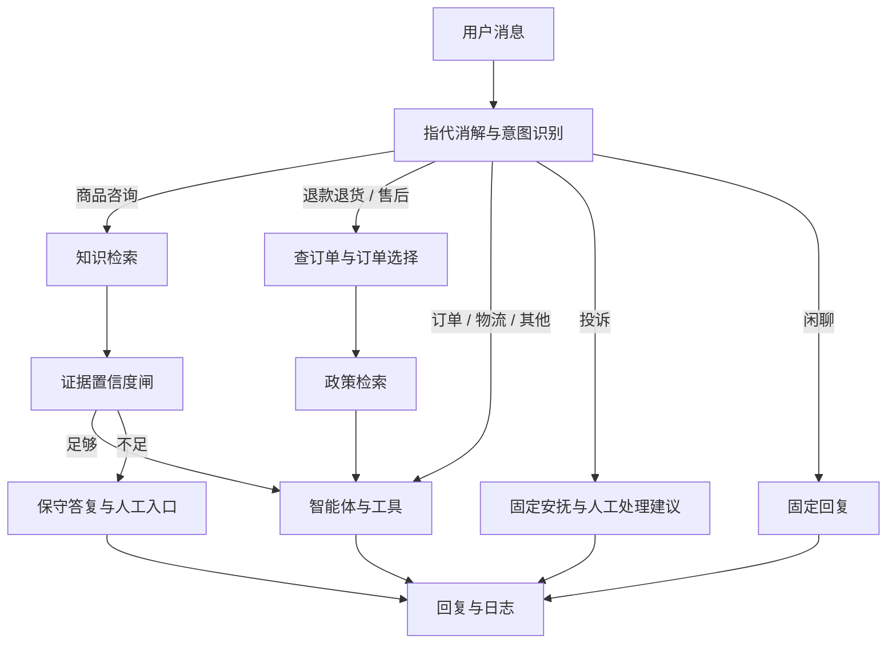

# Intelligent E-commerce Customer Assistant

电商智能客服系统，覆盖商品与活动咨询、订单查询和售后处理。通过 **Workflow（确定性工作流）与 Agent（智能体）混合架构**，把必经业务步骤交给流程控制，把工具选择和有据应答交给模型。

技术栈：Python、FastAPI、LangChain、LangGraph、Milvus、MySQL、MCP（模型上下文协议）、Langfuse（链路观测平台）、Transformers。

项目依据教程的需求与设计文档，按模块自行开发代码；商品、物流、订单和业务政策使用演示数据。已在全新虚拟环境和独立数据服务上完成 Windows 本地启动验收，模型文件复用已有缓存，详见[验收记录](docs/validation.md)。

## 已实现的模块

### 1. 对话接待与业务分流

目标：让不同问题走合适的处理流程。

- 商品咨询、退款退货、物流、订单、售后、投诉、闲聊和其他，共 8 类意图，映射到 5 个路由目标。
- 知识咨询先检索、再做证据校验；售后先取订单、再查政策；订单、物流等问题由智能体选择工具。
- 支持多轮指代消解、订单选择卡片、投诉安抚和人工处理入口。

### 2. 知识检索与有据应答

目标：让商品参数、活动规则和服务政策可以被检索、引用与核查。

- RAG（检索增强生成）：BGE-M3 语义向量 + BM25 关键词召回，通过 RRF（倒数排名融合）合并，再用 BGE-Reranker 重排序。
- Markdown（标记文档）按结构切分；MySQL 保存知识原文，Milvus 保存向量和可检索正文。
- 知识分支根据最高分、有效证据数量、分差三个信号计算置信度，证据不足时保守答复并给出人工入口。

### 3. 售后流程与工具治理

目标：让查询和写入操作具有明确边界。

- 售后按“查单 → 订单选择 → 政策检索 → 智能体判断”执行。
- 只读工具支持超时重试；写操作经过用户确认，不自动重试，并记录执行审计。
- 接入物流、售后两个 MCP 服务，支持工单和退款申请演示；未接真实支付、退款或企业订单系统。

### 4. 多轮上下文与链路观测

目标：让长对话保留必要背景，便于分析处理过程。

- 按预算分配近期原文、工具结果和早期摘要，异步压缩历史内容。
- SSE（服务器发送事件）推送工具状态、证据引用和回复；当前主链路终答聚合后分片发送。
- 可选接入 Langfuse，查看模型与工具调用链路。

### 5. 知识回流与审核（数据飞轮）

目标：让答不好的问题进入可检查的补充流程。

- 汇集检索低置信、生成自评不足和用户反馈问题，归并后进入人工审核。
- 审核答案写回知识库后再向量化，支持隔离历史知识及补齐失败任务。
- 审核通过与向量化尚非原子事务，失败需补齐，详见[限制说明](docs/architecture.md#已知边界)。

### 6. 本地主题分类

目标：统计低置信问题的主题分布，辅助定位知识缺口。

- 基于中文 RoBERTa 训练 17 类多标签分类器，包含数据治理、定向补丁与阈值扫描。
- 通过独立批处理接口和主题页面运行，不参与实时客服意图分流。

## 处理流程



知识分支的证据闸不会自动覆盖所有分支。详见[架构与工程边界](docs/architecture.md)。

## 冻结评估结果

结果来自各自固定评估集，不代表线上业务效果；启动验收另做少量真实模型调用，没有重新训练或重跑表中评估集。

| 模块 | 评估口径 | 结果 |
| --- | --- | --- |
| 混合检索 + 重排 | 2026-10-26，100 题中 73 题有参考证据 | Recall@5（前五条参考块覆盖率）98.17%；MRR（平均倒数排名）96.92% |
| 生成与拒答 | 同一轮，73 条有据题与 27 条库外题 | 73 条完成模型裁判，编造检出 0；27 条库外题均拒答；有据题中 6 条语义拒答 |
| 主题分类 | 固定 510 条测试集，阈值 0.40 | macro-F1（宏平均 F1）97.78%；micro-F1（微平均 F1）97.61%；完全匹配率 96.08% |

100 题为 **70 题完整有据、3 题部分有据、27 题库外**。模型未检出编造不等于人工确认回答全部正确。指标公式、配置差异和局限见[评估说明](docs/evaluation.md)，固定结果入口见 [evals/current.json](evals/current.json)。

无需安装项目依赖，即可核验文件和重新计算已有逐题指标：

```powershell
python evals/verify_release.py
```

该命令不连接数据库、不调用模型，不是一次新的模型性能评测。

## 本地启动

记录的开发环境为 Windows、Python 3.13.3。需要 Docker Compose、模型接口配置，以及本地嵌入/重排模型。完整步骤见[运行指南](docs/setup.md)。

以下以 PowerShell 为例：

```powershell
python -m venv .venv
.\.venv\Scripts\python.exe -m pip install -r requirements.txt -c constraints/windows-py313-validated.txt
Copy-Item .env.example .env
```

填写 `.env` 中的 `LLM_API_KEY`、`DB_PASSWORD` 等本地配置。PyTorch 的 CUDA（显卡计算平台）安装与已记录依赖版本见[环境说明](docs/environment.md)。

```powershell
docker compose up -d
docker compose -f docker-compose.milvus.yml up -d
# 等待容器健康后执行；先用 --plan 可只查看初始化顺序
.\.venv\Scripts\python.exe scripts/init_db.py --seed-demo-faq
# 向空知识表加载 39 条固定演示知识，并生成向量
.\.venv\Scripts\python.exe scripts/load_eval_knowledge.py
```

在三个终端分别启动服务：

```powershell
# 终端 1
.\.venv\Scripts\python.exe mcp_servers/logistics_server.py
# 终端 2
.\.venv\Scripts\python.exe mcp_servers/aftersale_server.py
# 终端 3
.\.venv\Scripts\python.exe -m uvicorn app.main:app --host 127.0.0.1 --port 8000
```

| 页面 | 地址 | 用途 |
| --- | --- | --- |
| 聊天 | http://127.0.0.1:8000/ | 商品、规则与订单售后咨询 |
| 知识库 | http://127.0.0.1:8000/kb | 浏览、录入、检索与建库 |
| 审核台 | http://127.0.0.1:8000/review | 审核待补充的问题 |
| 主题分布 | http://127.0.0.1:8000/topic | 可选分类器的批量分析 |
| 评估工作台 | http://127.0.0.1:8000/eval | 章节评估与台账；不等同于冻结公开结果 |
| 接口文档 | http://127.0.0.1:8000/docs | 请求与响应结构 |

可以先问“CFXB-40A 电饭煲容量多大”“可以用花呗分期吗”，再用“查询我的订单”检查工具交互。主对话接口是 `POST /api/agent/chat`。

## 可选模块与开发

- [Langfuse 与运行配置](docs/setup.md#可选-langfuse)
- [主题分类训练与评估](docs/training.md)
- [评估版本、离线核验和完整重跑](docs/evaluation.md)
- [本地启动验收记录](docs/validation.md)
- [代码、数据与第三方来源](docs/sources.md)

```powershell
# 本地逻辑测试；数据库、模型接口和 GPU 测试按说明单独运行
.\.venv\Scripts\python.exe -m pytest tests/ -m "not integration" -q
```

```text
app/             对话、工作流、知识、工具、上下文与分类接口
static/          聊天、知识、审核、评估与主题页面
mcp_servers/     物流与售后演示服务
scripts/         初始化、知识加载和治理工具
sql/             建表与演示 FAQ
knowledge_docs/  Markdown 演示知识
evals/           评估脚本、逐题记录与固定日期结果
training/        主题分类数据治理、训练与评估
tests/           单元与集成测试
docs/            运行、架构、评估和来源说明
```

真实配置、会话数据库、日志、备份、模型权重和原始采集记录不进入仓库。当前系统面向本地学习、验证与作品展示；第三方组件遵循各自许可，本项目许可证尚未指定。
